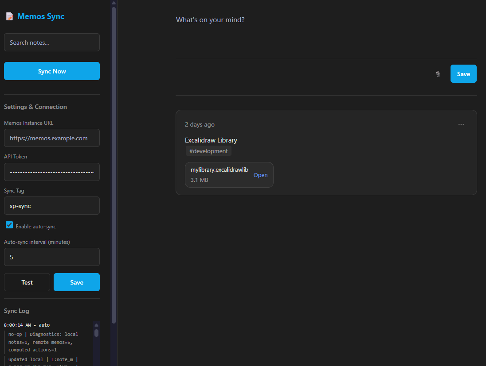

# Memos Sync

Plugin-owned notes in Super Productivity with two-way sync to Memos.

## What it is

Memos Sync adds a dedicated notes experience to Super Productivity and keeps those notes synchronized with [Memos](https://usememos.com/), the open source, self-hostable note-taking app.

This plugin is intentionally **note-centric**.

- It **does not** create or manage Super Productivity tasks.
- It stores its own local notes in plugin persistence.
- It syncs those notes with memos owned by the connected Memos account.

If you want a lightweight Memos-style notes flow inside Super Productivity, this plugin is built for that.

## Preview

## Features

- Two-way sync between plugin-owned local notes and Memos memos
- Card-based timeline UI inspired by Memos
- Sync all personal memos, including those without a tag
- Manual conflict resolution when both sides changed since the last successful sync
- Archive and restore notes, pin them, and choose their Memos visibility
- Attachment import and upload support
- Optional automatic sync on a user-defined interval, with live Memos events when supported
- Mini calendar for filtering local notes by creation date
- Markdown rendering with interactive checklists, local tag navigation, filters and date grouping
- Link preview cards and inline previews of supported image attachments
- Host theme colors and the official Memos logo
- Keyboard shortcuts for opening the plugin, creating a note, and running sync

## Quick start

1. Download the latest `memos-sync.zip` from GitHub Releases or workflow artifacts.
2. Import it in **Super Productivity → Settings → Plugins**.
3. Open **Memos Sync**.
4. Open **Settings** and enter your **Memos URL** and **API token**.
5. Click **Test Connection** and then **Save**.
6. Create a note locally or keep your memos in Memos ready for import.
7. Click **Sync Now**.

For a more detailed installation flow, see [docs/installation.md](docs/installation.md).

## How it works

### Local notes

You write and manage notes inside the plugin UI in Super Productivity.

- The composer at the top creates a new local note
- Clicking a card edits an existing note
- Attachments can be added from the composer
- Use the card menu to pin, archive, restore, or change a note's visibility. Archived notes appear in **Archived** rather than the main timeline.
- Click a hashtag to filter the timeline by that tag.
- Select a date in the mini calendar to filter notes by their local creation date; select it again or choose **Show all dates** to clear the filter.
- Filter pinned notes or notes with attachments, sort by creation or update date, or choose **Dates** to group notes by their local creation date.
- Markdown is rendered without raw HTML. Checklist controls change the note's Markdown text.
- Links can show a preview card when the Memos server supports link metadata. If a preview fails, the original link remains available and can be retried.

### Remote notes

On sync, the plugin:

- pushes local notes to Memos
- imports active and archived memos owned by the connected account, regardless of tags
- updates already linked notes on both sides

### Sync rules

- Local note creation creates a remote memo on sync
- Remote memos owned by the connected account are imported into the local timeline or Archived view
- When a linked remote memo cannot be found, the plugin preserves the local note and asks for confirmation before removing it. A missing memo can also mean access was lost.
- Local deletion removes the linked remote memo on the next sync
- If both sides changed, the plugin creates a conflict and asks you to choose which version wins

## Configuration

Open the plugin and configure:

- **Memos URL**: Base URL of your Memos instance
- **API Token**: Personal access token created in Memos
- **Enable auto-sync**: Optional automatic synchronization
- **Auto-sync interval**: Interval in minutes when auto-sync is enabled

The plugin no longer requires a sync tag. Previously linked notes retain their existing technical tag behavior for compatibility; new links preserve the memo content and tags as written. Memos belonging to other accounts are not imported, even if they are visible to the connected account.

Saving a note in the composer requests an immediate background sync when Memos is configured. If sync is already running, the save queues another pass.

When auto-sync is enabled, the plugin also listens for Memos change events when the server and host support authenticated streaming. It reconciles after reconnecting and retains interval sync as a fallback. Events are only hints; they never establish that a memo was deleted.

## Attachments

- Use **+ → Attach file** or **+ → Add image**, drop a file on the editor, or paste an image. Image thumbnails appear before saving.
- Open a saved audio attachment to play supported formats.
- New pending attachment bytes are stored on the device that added them. Run Memos Sync on that device to upload the files before opening them elsewhere.
- Attachments are uploaded to Memos on sync when supported by the remote instance
- Current Memos versions accept resumable chunks; the plugin saves upload progress and resumes interrupted sessions. Older versions use the original upload endpoint.
- If an older server may have accepted an upload but its response was lost, automatic retry is stopped to avoid duplicates. Check Memos before removing and reattaching the file.
- Imported remote attachments are shown in the local timeline
- PNG, JPEG, GIF, and WebP attachments are displayed inline when they can be read securely.
- **Open** fetches a remote attachment using the configured token in the request header, then previews supported raster images or offers a download. If the host or server blocks access, use **Memos** to open the service and locate the memo there.

## Markup

Open **+ → Markup** to sketch with Excalidraw. From a saved image attachment, choose **Open in Markup** to annotate it or reopen its embedded drawing. **Add to memo** saves a PNG preview and an editable `.excalidraw` scene. Use **Edit drawing** on the scene attachment to reopen it, then save the memo to update the attachments. Annotating a regular image leaves that original image in place.

Markup loads from the installed plugin. The editor and its bundled fonts do not require a CDN. The bundled fonts exclude the full Xiaolai set.

## Link a memo

Open **+ → Link memo**, search the content of your synced notes, and select a result. The link appears below the draft and syncs to Memos as a native reference after saving. Select a linked memo on a card to read it in a dialog. Use Back or Escape to return, or Edit memo to open the composer. To remove an outgoing reference, edit the source memo and remove its link.

## Composer and filters

The composer starts with private visibility. Its **+** menu also offers Markdown preview and focus mode. Drafts, including unsaved attachments, survive switching views during the current Super Productivity session.

Open **Filters & display** to save the current search, tag, date, note filter, and archive scope. Saved filters are stored on the current device. Open **Settings → Synchronization** for the status, manual sync, and sync log.

## Shortcuts

Open **Settings → Keyboard shortcuts** for the in-app reference.

Default Super Productivity bindings:

- **Open Memos Sync** — Ctrl + Alt + M
- **Create Memos Sync Note** — Ctrl + Alt + Shift + N
- **Run Memos Sync** — Ctrl + Alt + Shift + S

Inside the plugin view:

- **Ctrl/Cmd + N** focuses the new memo draft
- **Ctrl/Cmd + Enter** saves from the composer
- **/** focuses search outside editable fields
- **Arrow Down** moves from search into results. **Up/Down** browse results and **Enter** opens the selected memo
- **Esc** closes menus, exits preview or focus mode, or leaves the editor with the draft available for the current app session
- **Shift + Enter** inserts a new line
- **Ctrl/Cmd + Shift + S** triggers sync

Outside editable fields and open menus, unused key presses reach the Super Productivity shortcut handler when the host uses a same-origin plugin iframe. For example, **Shift + T** opens Today with the default host binding.

Shortcut registration depends on the Super Productivity host runtime. If your installation exposes plugin shortcuts in keyboard settings, you can customize them there.

## What this plugin is not

To avoid confusion:

- It is **not** a task sync plugin
- It does **not** mirror native Super Productivity tasks
- It does **not** replace Super Productivity task management
- It is a dedicated notes workflow that lives alongside your tasks

## Limitations

- Notes live in plugin storage, not as native Super Productivity tasks
- The API token is stored in Super Productivity plugin storage, not in a secure keychain
- Attachment handling depends on the Memos API exposed by your instance and proxy setup
- The plugin detects the current `/api/*` routes and falls back to `/api/v1/*` for older Memos instances. If the API returns HTML instead of JSON, check the base URL and reverse proxy routing.
- A `404` for a linked memo may mean deletion or lost access. Confirm the memo was deleted in Memos before approving local deletion.
- Memos `SPACE` visibility is preserved but cannot be edited in the plugin.
- The server must expose a supported authenticated current-user endpoint. Synchronization stops if account ownership cannot be verified.
- Existing local and remote notes without a shared mapping are not automatically deduplicated.
- Markdown links and images must use HTTP or HTTPS (links also support `mailto:`). External Markdown images are loaded directly by the browser and can disclose your IP address to their host.
- Link previews send the complete linked URL, including any query parameters, to your Memos server, which fetches the target page. Avoid links containing sensitive information if this is inappropriate for your server. Preview images are loaded directly by the browser and can disclose your IP address to their host.
- Link previews depend on the Memos link-metadata endpoint; unsupported endpoints or network failures do not affect sync or the original link.
- Private attachment preview depends on host and server network permissions; redirects are refused to avoid forwarding credentials.
- Live updates depend on authenticated streaming support. Interval sync remains active when streaming is unavailable.
- If a chunked upload session expires after finalization was attempted and the attachment cannot be retrieved, check Memos and the sync log before removing and reattaching it.

## Security notes

- Prefer a self-hosted or otherwise trusted Memos instance
- Do not share exported plugin state because it can contain the stored API token
- Do not commit real instance URLs, tokens, or personal note exports into this repository

## Development

- [docs/local-development.md](docs/local-development.md)
- [docs/architecture.md](docs/architecture.md)
- [docs/maintenance.md](docs/maintenance.md)

## Contributing

Please read [CONTRIBUTING.md](CONTRIBUTING.md) before opening a pull request.

## License

MIT

The Memos logo is distributed under its upstream MIT license, included as `LICENSE-MEMOS`. Its use identifies the service and does not imply affiliation or endorsement.
