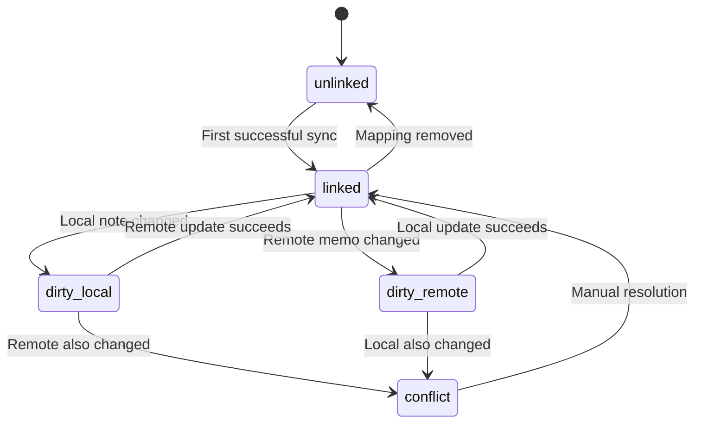

# Architecture

Overview of the Memos SP Plugin internal structure and data flow.

## Modules

- **adapters/memos-client**: Handles HTTP communication with the Memos REST API.
- **engine/sync-engine**: Computes sync actions between local plugin notes and remote memos.
- **types**: Defines local note, mapping, config, and sync log structures.
- **plugin host**: Owns local note storage, executes sync actions, and persists state.
- **ui panel**: Provides configuration, note editing, conflict resolution, and sync log views.
- **ui/markdown**: Renders Markdown with raw HTML disabled and restricted URL protocols; checklist changes are applied to the source note.

## State Machine

The sync engine tracks the relationship between a local plugin note and a remote memo.

## Storage Model

- **Local notes** are stored in plugin state and rendered only by the plugin panel.
- **Mappings** store the relationship between `localNoteId` and `memoId`.
- **Sync log** stores diagnostic entries and action results.
- **Plugin config** stores connection settings and the legacy sync tag for existing mappings.

## Data Flow

1. The user edits a local note in the plugin panel.
2. The plugin host stores the note in persisted plugin state.
3. `Sync Now` identifies the authenticated account, fetches all pages of active and archived memos and checks linked memos missing from the lists individually. It imports only memos owned by that account.
4. The sync engine compares local note snapshots, remote memo snapshots, and stored mappings.
5. The plugin host executes the returned actions.
6. Updated mappings and sync logs are written back to plugin storage.

The sync engine compares canonical snapshots of content, attachment references, archive state, pin state and visibility. Missing or inaccessible remote memos require explicit confirmation before the corresponding local note is removed.

The host serves the view as `srcdoc`. The Markdown renderer is bundled into `plugin.js` and exposed through the existing same-origin plugin interface, keeping `index.html` within the smaller HTML limits of older Super Productivity builds. The interface consumes the host's theme variables and updates when they change. Attachment reads use an authenticated host-side fetch without placing the token in a URL; inline previews and the attachment dialog use temporary blob URLs that are revoked when no longer needed.

Visible links can produce cards from the Memos link-metadata endpoint; the Memos server fetches the linked URL and the browser loads any metadata image directly. The original link remains available if metadata is unavailable. Preview data is UI-only and does not change note content or sync hashes. Preview requests are limited and cached within the view.

The optional event stream is authenticated via headers and only triggers debounced full reconciliation. Interval sync remains enabled; reconnecting triggers reconciliation. Concurrent runs are suppressed and a pending event is processed after the current run.

The sync scope does not use tag-filtered listings. Existing mappings retain their old technical tag behavior; new mappings preserve note content. Upload sessions store a stable attachment ID and progress in plugin state. A lost final response is resolved using that ID; an ambiguous legacy upload is not automatically repeated.

The host retains composer drafts while the plugin view is closed. New attachment payloads are stored in device-local IndexedDB, while plugin persistence holds their metadata and upload progress. The originating device uploads the pending bytes to Memos. Existing inline attachment data remains readable.

Markup uses a nested iframe so Excalidraw’s styles and keyboard handling stay within the drawing editor. The build stores the compressed editor document in `plugin.js` and checks the 5 MiB host limit. The plugin decompresses that document when the user opens Markup. Markup saves a PNG preview and a separate editable Excalidraw scene through the existing attachment flow. The PNG also carries embedded scene data for compatibility.

The synced plugin state is compressed before it reaches the host’s 256 KiB per-write limit. The loader also accepts older uncompressed JSON snapshots.
